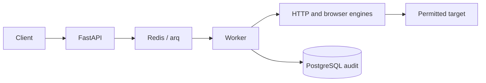

# Crawler API

### Fetch pages. Control proxies. Inspect every attempt.

FastAPI + arq worker + PostgreSQL + Redis. HTTPX/curl_cffi for HTTP;
Playwright Chromium and Camoufox Firefox for browser execution.

[Documentation](docs/README.md) · [User guide](docs/USER_GUIDE.md) ·
[API](docs/API.md) · [Operations](docs/runbook.md) · [CI](docs/CI.md)

> [!IMPORTANT]
> Release candidate: these guides describe interview-stable / PR #19, not the
> older master branch. Existing external deployments are not migrated by git pull.

## Start

Linux x86_64, Git, Docker with current Compose v2, Internet access and space for
browser images are required. No mandatory .env or host Python.

```bash
git clone --branch interview-stable https://github.com/softK1T/crawler-api.git
cd crawler-api
docker compose up -d --build --wait
curl -fsS http://127.0.0.1:8000/readyz
```

After merge into master, omit --branch. First build downloads dependencies and
browsers; later Docker-cache hits can be faster, not necessarily download-free.



Startup generates/persists a DB password, waits for services, applies migrations,
initializes the administrator key and checks real browser capabilities.
API: http://127.0.0.1:8000 · Swagger: http://127.0.0.1:8000/docs

```bash
API_KEY=$(docker compose exec -T api python scripts/stack_runtime.py key)
curl -fsS http://127.0.0.1:8000/v1/keys -H "X-API-Key: $API_KEY"
```

Do not print/commit the key or enable shell tracing. Issue narrower client keys.

| Included | Optional / not established |
|---|---|
| Scoped keys, jobs, batches, domain policy | WARC/S3 and callbacks off by default |
| Four engines, health and attempt audit | Provider sync/premium tiers off |
| Candidate import/checker; bring your own proxies | No guarantee of target-site access |
| Automatic migrations and persistent secrets | Native ARM64 not supported |

Camoufox 159.0-beta.42 is a recovered Linux x86_64 installation in this project's
release, checksum-pinned in Dockerfile. No upstream camoufox fetch is used.
The archive is about 1.36 GB; checksum is not an upstream signature.

> [!WARNING]
> Never run pytest against deployment DB/Redis or use down -v unless intentionally
> deleting data. Loopback baseline is not a completed production security audit.

Continue with [the documentation map](docs/README.md). For an existing external
server read [UBUNTU.md](UBUNTU.md), not a fresh-install recipe.
