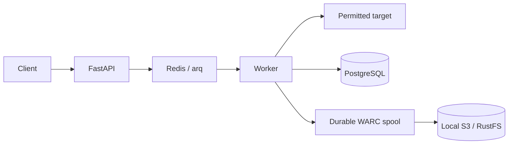

# Crawler API

Fetch web pages with HTTP and browser engines, manage proxy routing, and keep durable WARC archives in local S3-compatible storage.

## What it does

| Capability | What you get |
|---|---|
| HTTP and browsers | HTTPX, curl_cffi, Playwright/Chromium, Camoufox/Firefox |
| Background processing | Single jobs, batches, polling, optional bounded synchronous wait |
| Routing | Domain policies, proxy pools, escalation tiers, health and circuit breakers |
| Access management | Tenants, applications, scoped API keys, rotation and usage statistics |
| Archival | WARC objects in RustFS, PostgreSQL index, persistent delivery spool |



## Start here

| I want to... | Read |
|---|---|
| Install, update, or diagnose the stack | [Deployment and operations](docs/runbook.md) |
| Submit my first job and read an archive | [Usage guide](docs/USER_GUIDE.md) |
| Look up an endpoint, body, response, or error | [API reference](docs/API.md) |
| Change ports, concurrency, or integrations | [Configuration](docs/CONFIGURATION.md) |
| Understand isolation and production limits | [Security](docs/SECURITY.md) |

## Quick start

Requires Linux x86_64, Git, Docker with Compose v2, network access for the initial build, and space for browsers and archives. No mandatory `.env` or host Python. Native ARM64 is not supported by this image.

```bash
git clone --branch master https://github.com/softK1T/crawler-api.git
cd crawler-api
docker compose -p crawler-current -f docker-compose.yml build api
docker compose -p crawler-current -f docker-compose.yml pull postgres redis s3
docker compose -p crawler-current -f docker-compose.yml up -d --no-build --pull never --wait --wait-timeout 300
curl --fail-with-body http://127.0.0.1:8000/readyz
```

Run commands sequentially and stop on failure. Only `api` builds the shared application image. Startup prepares persistent credentials and migrations; `secrets` and `initialize` should exit with code 0.

- API: `http://127.0.0.1:8000`
- Interactive reference: `/docs`; machine-readable contract: `/openapi.json`
- S3 console: `http://127.0.0.1:9001`; S3 API stays inside Docker.

For an existing installation, follow the [update procedure](docs/runbook.md#update-an-existing-stack), not the fresh-install recipe. Never change its Compose project name or delete its volumes to repair a startup error.

## Important boundaries

WARC/local S3 are enabled. Provider sync, premium proxy tiers, callbacks, and tracing are disabled by default. Fetch completion is not a guarantee of valid target content. Archive access and administration are not isolated by application; grant these scopes only to trusted operators. This loopback stack is not a completed public-production security audit.

All project documentation, code comments, user-facing messages, and commit messages must be written in English.

[Documentation index](docs/README.md) · [Architecture](docs/ARCHITECTURE.md) · [Design decisions](docs/DESIGN.md) · [Development](docs/DEVELOPMENT.md)
