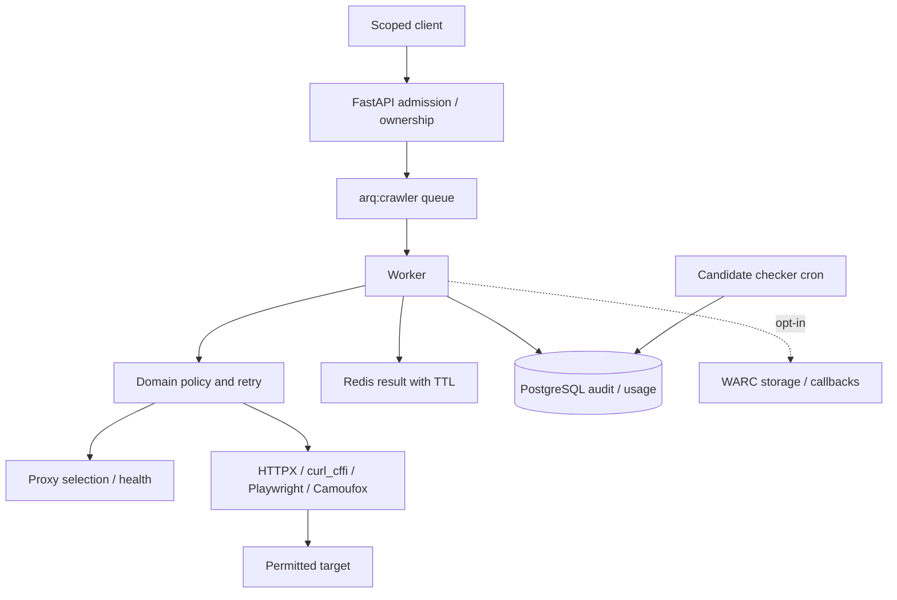
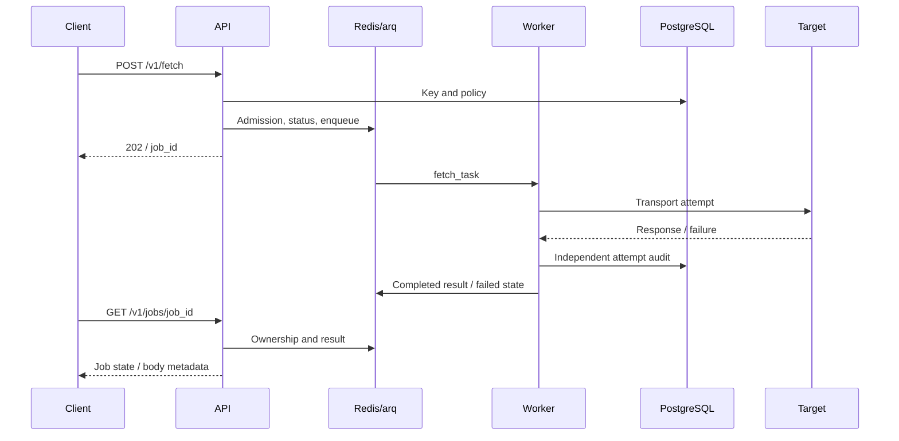

# Architecture

[Documentation](README.md) · [API](API.md) · [Configuration](CONFIGURATION.md)

## Boundary

The service accepts URLs, executes fetch jobs and returns normalized responses.
Shop-specific extraction, catalog scheduling and login/CAPTCHA orchestration are
not supplied by the /projects/ tenant-compatibility API.

## Lifecycle

Compose secrets initializer → healthy PostgreSQL/Redis → migration/key initializer
→ API and worker. The entrypoint constructs DATABASE_URL from the persisted secret
before importing the app. Worker launches real browser checks and publishes a
short-lived capability heartbeat; /readyz requires it, DB and Redis. /healthz is
liveness only. Named volumes retain DB, Redis AOF and credentials.

## Policy and engines

Registered-domain normalization shares policy across many subdomains. Policy engine
can override mode; explicit proxy filters and retry state also affect routing.
Pool selection comes from domain policy, not application identity.

| Tier | Engine | Default route |
|---|---|---|
| 0 | HTTPX | Direct |
| 1 | HTTPX | Datacenter |
| 2 | curl_cffi | Datacenter |
| 3 | curl_cffi | Residential |
| 4 | Playwright | Residential |
| 5 | Camoufox | Residential |
| 6 | Camoufox | Mobile |

Premium tiers are off by default; explicit browser requests have additional engine
handling. The table is not a target-access guarantee. policy.max_retries is a
per-tier cap; max_escalation_attempts bounds total attempts. Unknown-type candidates
need an intentional override, not an invented commercial classification.
Playwright reuses a bounded Chromium process with fresh contexts; Camoufox has its
own guarded launch/concurrency path. Software guards are not network isolation.

## State and durability

PostgreSQL holds identity/keys, global policies/pools/proxies, per-attempt request_log,
usage counters and optional warc_index. Redis holds admission, queue, finite-lived
job/batch results, sticky state and breakers. Optional S3/DLQ handles archival.
Job/batch reads check application ownership; global administration and optional
archive exposure have different boundaries. See SECURITY.md.

Audit writes use an independent session. Failure increments
crawler_request_log_write_failures_total but does not fail the crawl. Shutdown drains
tracked shielded writes for a bounded time. Completed jobs may still be blocked or
non-2xx; body integrity and content correctness are separate from task completion.

## Source map

| Area | Code |
|---|---|
| HTTP | app/api/v1/endpoints/, app/schemas/ |
| Queue/results | services/job_service.py, batch_service.py |
| Orchestration | worker/tasks/fetch_task.py |
| Transport/guards | services/fetchers/ |
| Candidate/probe policy | services/proxy_candidates.py, proxy_geo* |
| Checker | worker/tasks/proxy_candidates.py |
| Attempt persistence | services/request_attempt_log.py |
| Deployment | scripts/stack_runtime.py, Dockerfile, docker-compose.yml |

Paths under services/worker above are relative to app/. Older statements that
Camoufox is deferred or browser pooling absent are historical, not this revision.
